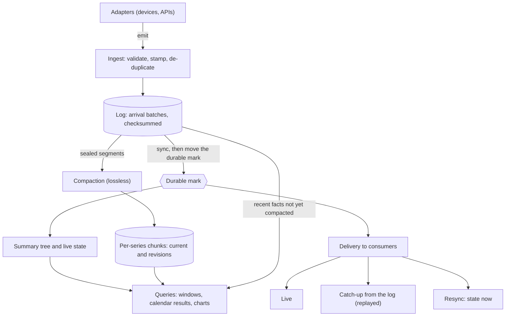
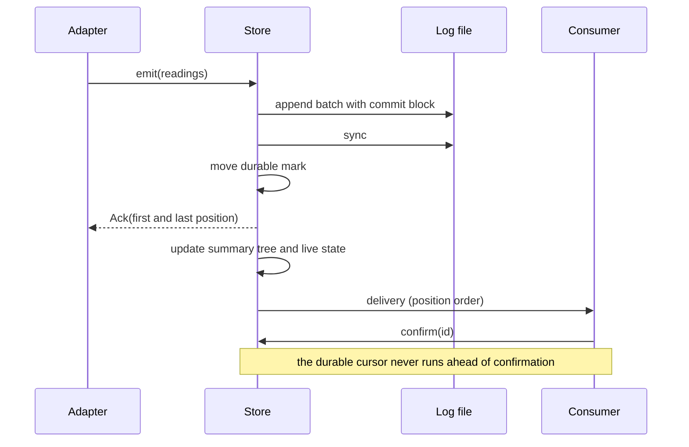
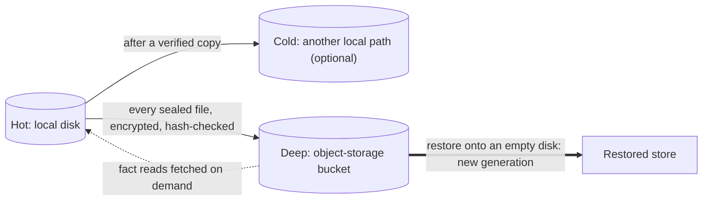

# kvik

[](https://github.com/hugsmid/kvik/actions/workflows/ci.yml)

**A planned embedded time-series store for device and sensor data, in Rust: a durable ordered log and an analytical store
in one library, with no database service.**

kvik is designed to sit inside the application that talks to the devices. Readings go into a checksummed, append-only
log and are synced to disk before anything reacts to them; the same library then delivers them to in-process
consumers, keeps per-series summaries for drill-down from years to seconds, and moves old files to cheaper storage
and an off-site bucket; the engine itself never deletes a fact. Typical uses are home and building automation, energy
monitoring, small industrial or laboratory installations and edge devices: places where per-second data from many
sources must be acted on quickly, kept for years and restored to a known, recorded point after a failure.

> [!IMPORTANT]
> **Status: design stage. The engine does not exist yet.**
>
> - The [specification](docs/spec.md) is tagged **v0.2**.
> - A slow, exact [reference model](model/) of its semantics exists, with property tests and edge-case tests; a few
>   newer rules are not yet modelled ([coverage table](model/README.md#coverage)).
> - The first measurement, of chunk encodings against Parquet, is [recorded](docs/measurements/2.1-chunk-encodings.md).
>
> | [Roadmap](docs/roadmap.md) section | Progress |
> |---|---|
> | 1. Specification settled | 8 of 8 done |
> | 2. Measurements before building | 1 of 3 done, in progress |
> | 3–10. Format and interface, log, delivery, compaction, summary tree, tiers and backup, query, scale | not started |
>
> 9 of 46 roadmap items are done.

## Principles
From [spec §1, §2.4 and §8](docs/spec.md#1-principles):

- **Durable before anything reacts.** A batch of readings is synced and the durable mark moved before adapters are
  acknowledged, summaries are updated or any consumer or reader process sees it.
- **Late and corrected data are recorded.** A reading is never edited in place; a correction is a new fact and the
  old one stays as a revision. Sources that revise what they have published declare a *versioned series*, so a
  replay cannot undo a correction that carries a higher `changed_at`.
- **Facts are immutable; everything else is derived.** The summary tree, indexes, compacted layout and funnel
  state are pure functions of the log entries and the configuration recorded in them, so each can be rebuilt from the facts. Rebuild-equals-live is a test.
- **Data moves; the engine never deletes it.** A file leaves fast local disk for cold or deep storage only after a
  hash-verified copy exists there, and there is no purge. Losses the engine cannot prevent, such as a corrupt block
  with no other copy or a file the bucket has lost when a restore reads it, are recorded as lost ranges and reported as `data_lost`.
- **No silent loss.** Anything refused, repeated, flagged or delayed is counted and visible.
- **Restore to a known point.** A restore from the bucket starts a new generation and is restored to a known,
  recorded point. Positions beyond it that reached the bucket are set aside: kept and exportable, never silently
  mixed in. Facts in files that were never backed up are lost.
- **One writer process, any number of readers**, including readers in other processes while the writer runs.

**Not planned for v1:** a network server, SQL, multiple writers, clustering, or any form of deletion
([`docs/api.md`](docs/api.md#not-in-v1)).

## How it works
The intended shape, from [`docs/design.md`](docs/design.md) and the [specification](docs/spec.md):



Each batch is one commit and one sync; while a sync is in flight, new readings form the next batch. Only after the
sync and the durable mark do the summary tree and live state update and consumers receive the batch. A consumer that falls behind catches up
from the log without blocking the writer or other consumers; one that was away too long receives a `resync` with
the present state instead of a stale replay. Compaction later rewrites sealed log segments into per-series chunks,
keeping every fact with its position. Queries combine whole summary nodes in the middle of a window with raw facts
at its edges, so results are exact to the nanosecond where the detail is local, and carry their coverage. A window never reads
off-machine data: where an edge's detail is not local, the edge moves inward and the result is flagged
`approximate_edges`, or is the error `detail_not_local` if no span is left.

### A reading, from emit to delivery



### Tiers, backup and restore



The stored summary tree, indexes and registry never leave hot. At 90 days, revision chunks and sealed log segments
leave hot once verified in cold or deep; current detail stays hot except under fill pressure or for a series with a
diagnostic retention class. Cold is another local path, read in place. Detail held only in the bucket is fetched on
demand for fact reads, never for windows or consumer catch-up. The engine never deletes from the bucket.

### Key concepts

| Concept | Meaning |
|---|---|
| Fact | One recorded reading: series, event time `t`, value, quality, flags, position. Never edited or deleted |
| Position | `(generation, sequence)`, gap-free within a generation except recorded lost ranges; orders every log entry |
| Series | A named stream with a fixed kind (gauge, counter, state, text, interval), value type and unit |
| Versioned series | A series whose source revises readings; each carries `changed_at`, and the highest revision wins |
| Window | A rolling or calendar span evaluated in event time; every result carries coverage and flags |
| Calendar result | A local day or month in a configured or named time zone, evaluated as a window over UTC data |
| Consumer | In-process code fed by funnels (selection, optional windowed operator, condition), with a durable cursor |
| Resync | A delivery carrying the present live and condition state, sent where a replay would be wrong or impossible |
| Tier | Hot local disk, optional cold path, deep bucket; files move between them only after a verified copy |

### Planned interface
*Subject to change: an outline from [`docs/api.md`](docs/api.md), not yet implemented.*

```rust
let store = Store::open(config).await?;   // StoreConfig: directory, time zone, limits, tiers, ...

let id = store.define_series(SeriesSpec {
    name: "plant/line-1/temperature".into(),
    kind: Kind::Gauge { value: ValueType::Decimal { scale: 1 } },
    unit: "°C".into(),
    ..Default::default()
}).await?;

// Resolves only after the batch is synced and the durable mark has moved.
let ack = store.emit(&[Reading { series: id, t, value, quality, source: TimeSource::Device }]).await?;

let reader = Reader::open(path).await?;   // read-only; may be another process
let w = reader.window(id, Window::rolling(Duration::from_secs(600)), Aggregate::Avg)?;
// WindowResult { value, coverage, from, to, flags }
```

## How it is being built
1. **Specification first.** [`docs/spec.md`](docs/spec.md) states the rules, edge cases and invariants. Gaps found
   along the way are recorded in [`model/OPEN-QUESTIONS.md`](model/OPEN-QUESTIONS.md), not settled silently.
2. **An exact reference model.** [`model/`](model/) implements the semantics in memory with exact rationals, so
   tree nodes, merges and windows are compared with direct computation for equality. Property tests check the
   invariants of spec §10 that the model covers; CI runs them with 10,000 cases on every change and 40,000 nightly.
3. **Measurements before building.** Roadmap item 2.1 compared candidate chunk encodings with Parquet on synthetic
   per-second data: the own encoding was 8–14 % smaller than Parquet with ALP for decimal readings stored as
   `f64`, but only about 1 % smaller when they are declared as scaled `i64`. On two non-decimal shapes it was 13 %
   smaller than the best Parquet variant on one and 23 % larger than Parquet's dictionary encoding on the other
   ([results](docs/measurements/2.1-chunk-encodings.md)). Whether compacted data stays in its own format or in
   Parquet is decided at later gates.
4. **The engine against the model.** Each part (log, delivery, compaction, summary tree, tiers, query) will be
   built behind injectable clock and file-system seams and tested differentially against the model, with crash points,
   failed syncs and full disks injected.

Design budgets, still to be measured: a reading delivered to an in-process consumer within p50 ≤ 2 ms and
p99 ≤ 10 ms of acceptance on an SSD, sync included; a chart query at any zoom level within 50 ms; restart to serving within
1 s ([`docs/design.md`](docs/design.md)).

## Repository map

| Path | Contents |
|---|---|
| [`docs/spec.md`](docs/spec.md) | The specification (v0.2): the rules an implementation must follow |
| [`docs/design.md`](docs/design.md) | Design direction, performance budgets, build order |
| [`docs/roadmap.md`](docs/roadmap.md) | Roadmap and status, one pull request per item |
| [`docs/format.md`](docs/format.md) | Proposed byte-level format; not yet checked for implementability (roadmap 3.1) |
| [`docs/api.md`](docs/api.md) | Proposed public interface; not yet checked for implementability (roadmap 3.2) |
| [`docs/measurements/`](docs/measurements/) | Recorded measurements |
| [`model/`](model/) | `kvik-model`: a slow, exact, in-memory reference model of the specification, with property tests |
| [`model/OPEN-QUESTIONS.md`](model/OPEN-QUESTIONS.md) | Open questions in the specification, and where the model still differs from it |
| [`spikes/encodings/`](spikes/encodings/) | The encoding spike behind roadmap item 2.1; not part of the engine |

## Running the checks

```bash
cargo fmt --all --check
cargo clippy --all-targets --locked -- -D warnings
cargo test --locked                  # the reference model
cargo test --locked -p encodings     # the encoding spike
cargo run --example basic            # a small tour of the model
```

See [CONTRIBUTING.md](CONTRIBUTING.md) for how changes are made and [SECURITY.md](SECURITY.md) for reporting
vulnerabilities.

## Licence
Licensed under either of [Apache License, Version 2.0](LICENSE-APACHE) or [MIT licence](LICENSE-MIT) at your
option. Unless you explicitly state otherwise, any contribution intentionally submitted for inclusion in this
work, as defined in the Apache-2.0 licence, shall be dual licensed as above, without any additional terms or
conditions.
